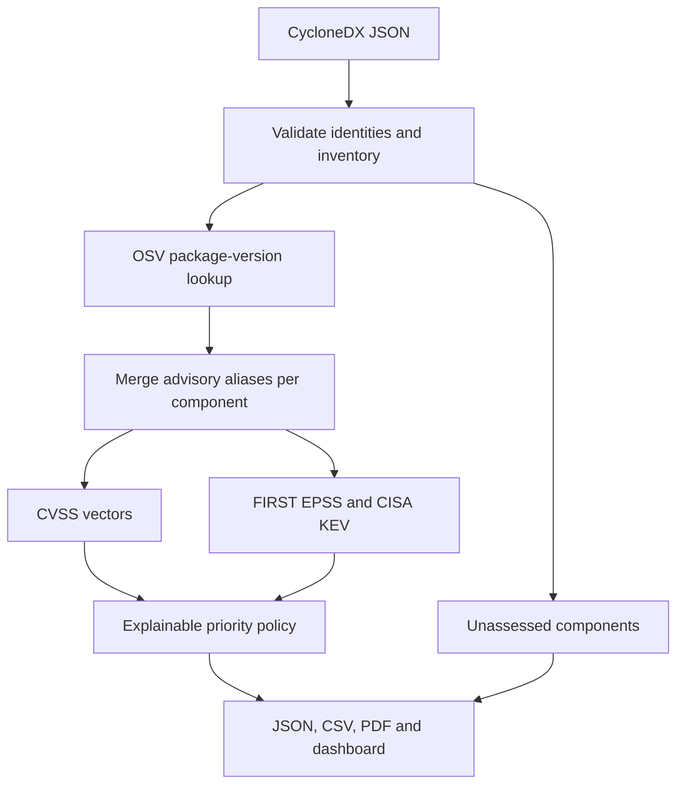

# SBOM vulnerability triage

A Python portfolio project that turns a **CycloneDX JSON** inventory into an explainable investigation queue. OSV matches package versions; CVSS vectors describe severity; FIRST EPSS and CISA KEV enrich CVE aliases. A Streamlit dashboard and CSV, JSON and PDF exports make the evidence reviewable.

**Educational decision support.** This is not a validated medical-device security system, a penetration test, or a patient-safety risk assessment. An unmatched component is not proven safe. The offline demo uses synthetic API responses and scores.

## Quick start — Windows 11 / PowerShell

Install Python 3.11 or newer. Clone [the repository](https://github.com/sumant30s/sbom-triage) or extract the project ZIP, then run these commands from the project folder:

```powershell
py -m venv .venv
.\.venv\Scripts\python.exe -m pip install -e ".[dev]"
.\.venv\Scripts\sbom-triage.exe --demo --output reports/demo
.\.venv\Scripts\python.exe -m streamlit run app.py
```

The demo deliberately contains an unidentifiable firmware component. It writes all three reports and returns **exit code 3 (partial coverage)**. This is expected. Click **Load offline demo** in the dashboard.

On Linux/macOS:

```bash
python3 -m venv .venv
.venv/bin/python -m pip install -e '.[dev]'
.venv/bin/sbom-triage --demo --output reports/demo
.venv/bin/python -m streamlit run app.py
```

## Live scan

```powershell
.\.venv\Scripts\sbom-triage.exe examples/live-sbom.cdx.json --output reports/live
```

No API keys are required. Live mode sends **package identifiers and versions to OSV**, and **CVE IDs to FIRST**. It fetches the public CISA catalog. The full SBOM is not uploaded. Use only inventories you are authorized to disclose to these services. The sample uses an old Log4j version for lookup only; the vulnerable library is never installed or executed.

To generate your own SBOM after installing Syft separately:

```powershell
syft dir:. -o cyclonedx-json=sbom.cdx.json
grype sbom:sbom.cdx.json
.\.venv\Scripts\sbom-triage.exe sbom.cdx.json --output reports/my-project
```

Syft and Grype are separate tools, not Python dependencies. Run scans on an appropriate source tree or built artifact: a project directory and an installed runtime can contain different dependencies. This tool has narrower package coverage than a general SCA scanner. Compare the **intersection of supported packages**, not just raw vulnerability counts.

## What is implemented

- Bounded CycloneDX 1.4–1.7 JSON parsing, nested components and `metadata.component`.
- Exact supplied version retained; missing or conflicting identities are flagged.
- OSV lookups by versioned package URL (purl), pagination and per-run query reuse.
- Transitive alias deduplication within each component; withdrawn advisories ignored.
- CVSS v2/v3/v4 vector calculation with source vectors preserved.
- EPSS in bounded batches, score dates and per-CVE values retained.
- CISA KEV catalog matching with catalog provenance and an official CISA GitHub mirror fallback.
- P0–P3 priority plus a human-readable reason and explicit unknown values.
- HTTP timeouts, bounded retry/backoff, `Retry-After` handling and partial-result reporting.
- Streamlit severity charts, queue filters, evidence inspector and scan-coverage table.
- CSV formula protection, full JSON evidence and paginated PDF export.
- pytest tests, dashboard interaction tests, Ruff and Bandit checks.

## Architecture



Read the code in this order: `sbom.py` → `clients.py` → `triage.py` → `reports.py` → `cli.py` → `app.py`. `demo.py` supplies deterministic responses without internet access.

## Priority policy

The first matching rule wins. These are **project-defined thresholds**, not FIRST/CISA requirements or organizational patch deadlines.

| Priority | Trigger | Suggested next step |
|---|---|---|
| P0 | Any CVE alias is in KEV | Urgently assess applicability, exposure and mitigation |
| P1 | CVSS ≥9.0 or EPSS ≥0.10 | Prompt investigation and remediation planning |
| P2 | CVSS ≥7.0, EPSS ≥0.01, or incomplete evidence | Investigate missing evidence and track |
| P3 | Complete evidence below those thresholds | Review and track |

Within each tier, sort by EPSS, then CVSS, then deterministic package/ID tie breakers. A missing value is `null`, never zero. KEV `false` means absent from a successfully retrieved catalog; it does **not** prove there is no exploitation.

CVSS is technical severity. EPSS estimates the probability of exploitation in the next 30 days. KEV records known exploitation. None establishes reachability or patient impact in a particular product. The highest supplied CVSS score is used conservatively and all vectors are retained; this is **not a numeric conversion between CVSS versions**. When an alias group contains several CVEs, the maximum EPSS is used and every per-CVE value is retained.

Reachability and VEX do not automatically suppress findings. A human should document product version, exposure, configuration, call-path evidence, compensating controls, review owner and decision date. In a medical-device setting, include clinical impact and change validation before deployment. CISA catalog due dates are source evidence, not automatically your organization's deadlines.

## Coverage and exit codes

| Exit | Meaning |
|---|---|
| 0 | Scan coverage complete; no configured priority gate triggered |
| 1 | `--fail-on P0/P1/P2/P3` reached, with complete coverage |
| 2 | Invalid input, file or output error |
| 3 | Partial coverage: skipped package, failed lookup or failed enrichment source |

Partial coverage takes precedence over the priority gate. A complete scan can still have findings with missing scores; `summary.needs_review` tracks these, and they cannot fall below P2 solely because evidence is missing. `--fail-on P2` gates those findings. No results from OSV are labeled `no_known_match`, never `safe`.

## Input and scope limits

- Supported purl types: `pypi`, `npm`, `maven`, `golang`, `cargo`, `nuget`, `gem`, `composer`. Provider coverage still varies.
- Requires an explicit version in the component or purl. Names alone are never guessed into an ecosystem. OSV decides version applicability; its upstream version matching can be fuzzy.
- Maximum 5 MiB input, 500 components, 30 nested levels and 20 OSV pages per package.
- Validates the fields it uses; **not a full CycloneDX schema validator**.
- No NVD/CPE matching, firmware analysis, malware/secret detection, CBOM analysis, VEX ingestion, dependency-path analysis, persistent caching or multi-user authentication.
- Package-specific fixed-version ranges are retained as evidence. No automatic safe-upgrade recommendation is derived from an arbitrary `fixed` event.
- Run the dashboard locally. Hosting it for multiple users would need authentication, quotas, stronger isolation and input/output policies.
- PDF embeds the Latin fonts bundled with ReportLab; JSON/CSV retain full Unicode. Very large reports and unusual scripts need further layout work.

## Tests and checks

```powershell
.\.venv\Scripts\python.exe -m pytest -q
.\.venv\Scripts\python.exe -m ruff check .
.\.venv\Scripts\python.exe -m bandit -q -r src app.py
```

Tests mock external APIs; they do not depend on live vulnerability scores. CI runs them on Linux and Windows with Python 3.11/3.12, with Ruff and Bandit checks. Separate jobs run Semgrep and Trivy. [The verified hosted run](https://github.com/sumant30s/sbom-triage/actions/runs/41271276645) passed all six jobs.

Trivy scans the pinned `requirements-tested.txt` snapshot under the recognized `requirements.txt` filename. A coverage check requires every pinned name/version to appear in its JSON report, so an empty scan cannot silently pass. The report is retained as a workflow artifact for seven days. This checks the recorded snapshot, not every newly resolved matrix environment; refresh the snapshot after dependency updates.

## Learn and explain this project

- [Days 6–9 build and practice guide](docs/days-6-9.md)
- [Interview walkthrough and honest limitations](docs/interview.md)
- [Validation record](docs/validation.md)

## Primary references

- [CycloneDX JSON reference](https://cyclonedx.org/docs/1.6/json/)
- [OSV package query and pagination](https://google.github.io/osv.dev/post-v1-query/)
- [OSV schema](https://ossf.github.io/osv-schema/)
- [FIRST EPSS API](https://api.first.org/epss/) and [EPSS overview](https://www.first.org/epss/)
- [CISA KEV catalog](https://www.cisa.gov/known-exploited-vulnerabilities-catalog), [official JSON feed](https://www.cisa.gov/sites/default/files/feeds/known_exploited_vulnerabilities.json), and [CISA's official mirror](https://github.com/cisagov/kev-data)
- [CVSS Python implementation](https://github.com/RedHatProductSecurity/cvss)
- [Streamlit AppTest](https://docs.streamlit.io/develop/api-reference/app-testing)
- [Syft](https://github.com/anchore/syft) and [Grype](https://github.com/anchore/grype)

Dependencies use bounded version ranges. `requirements-tested.txt` records the full environment used for validation; it is a reproducibility snapshot, not a promise that dependencies remain vulnerability-free.
